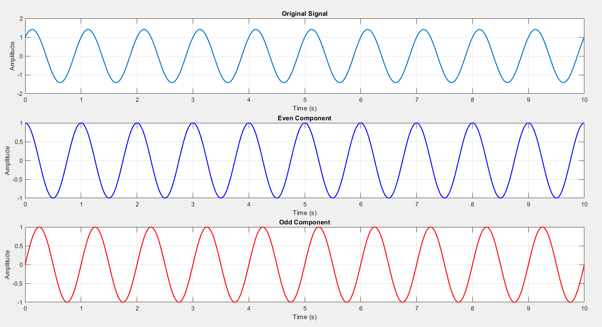
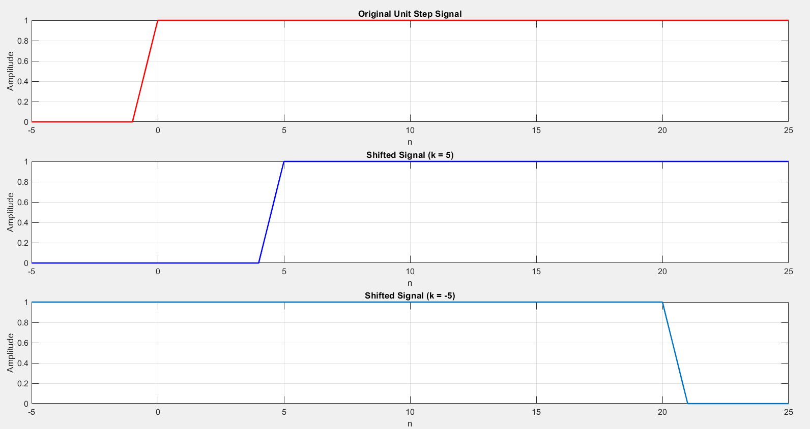
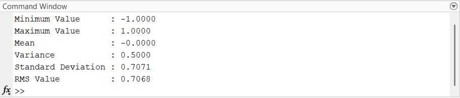
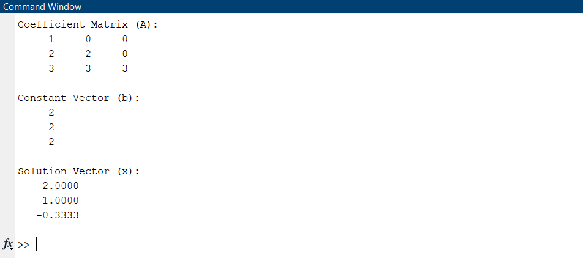

# 📊 LAB - 02: Operations on Signals, Linear Algebra & Statistical Analysis

## 🎯 Objectives
* Decompose arbitrary signals into symmetric (even) and anti-symmetric (odd) components.
* Implement forward and backward discrete-time sequence shifting with boundary handling.
* Solve systems of linear algebraic equations ($A \mathbf{x} = \mathbf{b}$) via matrix inverse operations in MATLAB.
* Extract statistical features from signals: minimum, maximum, mean, variance, standard deviation, and RMS value.

---

## 📂 Source Code & Description

| Script / Function | Type | Description | Key Functions |
| :--- | :---: | :--- | :--- |
| [`components.m`](components.m) | Helper Function | Computes even component $x_e(t) = \frac{x(t)+x(-t)}{2}$ and odd component $x_o(t) = \frac{x(t)-x(-t)}{2}$ | `fliplr`, `subplot`, `plot` |
| [`even_odd.m`](even_odd.m) | Driver Script | Generates composite sinusoid $x(t) = \sin(2\pi t) + \cos(2\pi t)$ and evaluates even/odd parts | `linspace`, `components` |
| [`shiftSignal.m`](shiftSignal.m) | Helper Function | Shifts sequence $x[n]$ by $k$ positions with zero-padding | Array slicing, conditional bounds |
| [`SignalShifting.m`](SignalShifting.m) | Driver Script | Demonstrates time advance ($k = -5$) and time delay ($k = +5$) on a unit step sequence | `shiftSignal`, `subplot` |
| [`Solution_of_LE.m`](Solution_of_LE.m) | Script | Solves lower triangular linear matrix equation $A\mathbf{x} = \mathbf{b}$ | `inv(A)*b`, `disp` |
| [`stat_functions.m`](stat_functions.m) | Script | Computes statistical characteristics of a $2\ \text{Hz}$ sinusoidal signal | `min`, `max`, `mean`, `var`, `std`, `rms` |

---

## 📈 Waveform & Simulation Outputs

### 1. Even and Odd Signal Decomposition

### 2. Time Shifting of Discrete Sequences ($k = \pm 5$)

### 3. Solution of Linear Equations ($Ax = b$)

### 4. Statistical Characterization Output

