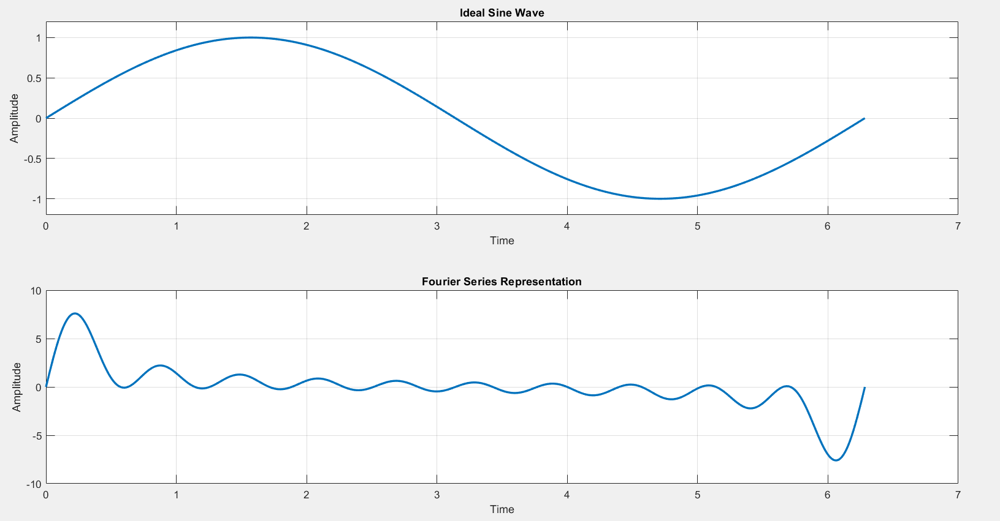
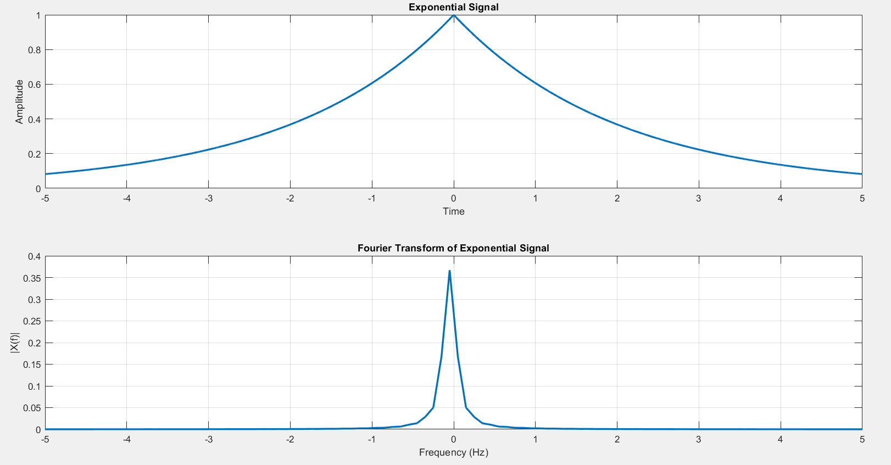

# 📊 LAB - 03: Fourier Representations & Frequency Domain Analysis

## 🎯 Objectives
* Approximate periodic waveforms by synthesizing truncated Fourier series expansions with user-selected harmonic orders ($M$).
* Analyze the frequency content of continuous-time signals using the Fast Fourier Transform ($\text{FFT}$).
* Plot two-sided centered magnitude spectra using `fftshift`.

---

## 📂 Source Code & Description

| Script | Topic | Description | Key Functions / Operators |
| :--- | :--- | :--- | :--- |
| [`Fourier_Representation.m`](Fourier_Representation.m) | **Fourier Series Synthesis** | Reconstructs periodic signals by summing $M$ harmonic sinusoids ($f_s(t) = \sum_{n=1}^M b_n \sin(nt)$) | `for` loop, `sin`, `subplot`, `grid` |
| [`Fourier_Transform.m`](Fourier_Transform.m) | **Continuous / Discrete FFT Spectrum** | Computes the continuous-like Fourier Transform of symmetric exponential signal $x(t) = e^{-0.5|t|}$ and displays centered magnitude $|X(f)|$ | `fft`, `fftshift`, frequency axis scaling |

---

## 📈 Waveform Outputs

### 1. Fourier Series Harmonic Approximation

### 2. Fourier Transform Magnitude Spectrum ($|X(f)|$)

