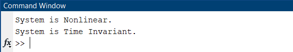
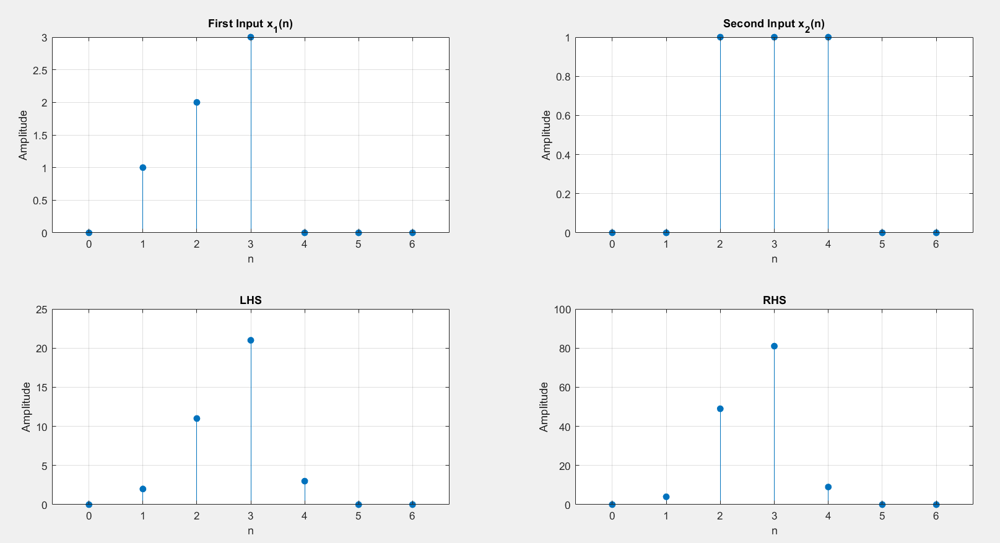
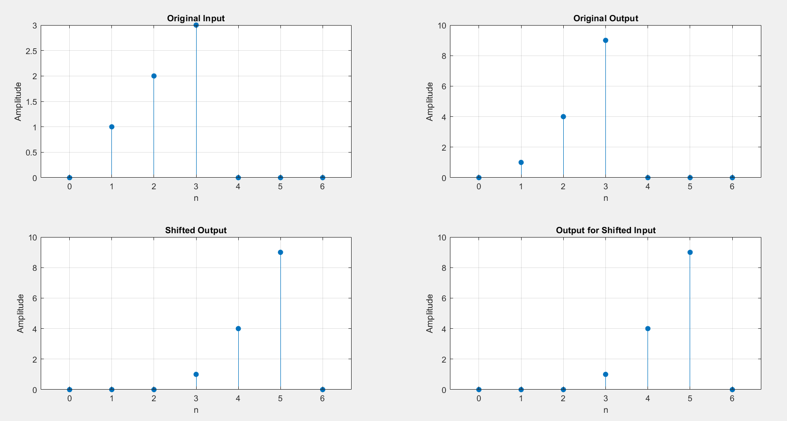
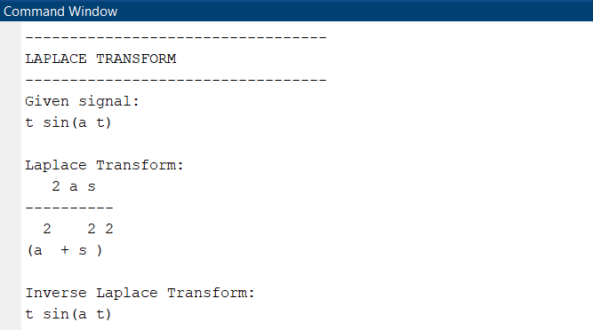
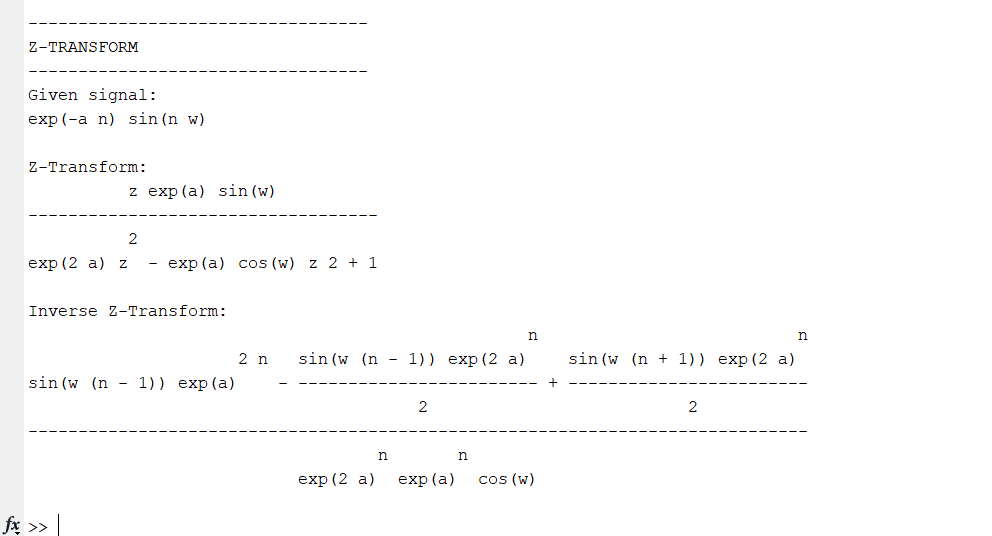
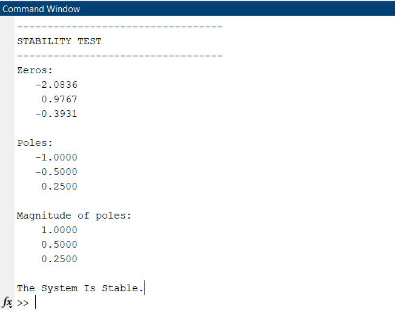
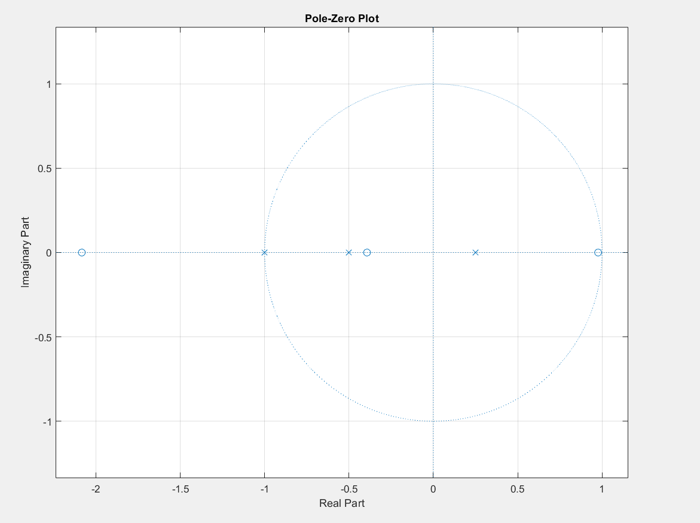

# 📊 LAB - 04: System Properties, Transform Domain & Stability Analysis

## 🎯 Objectives
* Empirically verify linearity (superposition and homogeneity) and time-invariance of dynamic systems.
* Apply MATLAB Symbolic Math Toolbox for evaluating forward and inverse Laplace ($\mathcal{L}$) and Z-transforms ($\mathcal{Z}$).
* Determine pole-zero locations of rational discrete transfer functions and verify Bounded-Input Bounded-Output (BIBO) stability via the Z-plane unit circle criterion ($|p_i| < 1$).

---

## 📂 Source Code & Description

| Script | Topic | Description | Key Functions |
| :--- | :--- | :--- | :--- |
| [`LAB0401.m`](LAB0401.m) | **Linearity & Time-Invariance Tests** | Evaluates non-linear squaring operator $y[n] = x^2[n]$; verifies failure of superposition ($LHS \ne RHS$) and time-invariance properties | `stem`, `isequal`, array exponentiation |
| [`LAB0402.m`](LAB0402.m) | **Laplace & Z-Transforms** | Computes symbolic Laplace transform of $f(t) = t \sin(at)$ and Z-transform of $x[n] = e^{-an}\sin(\omega n)$, with inverse transform verification | `syms`, `laplace`, `ilaplace`, `ztrans`, `iztrans`, `pretty` |
| [`LAB0403.m`](LAB0403.m) | **Stability & Pole-Zero Mapping** | Evaluates transfer function $F(z) = \frac{2z^3 + 3z^2 - 3.2z - 1.6}{2z^3 + 2.5z^2 + 0.25z - 0.25}$, maps poles/zeros via `zplane`, and checks unit circle containment | `tf2zpk`, `zplane`, `abs(poles) < 1` |

---

## 📈 Waveform & Simulation Outputs

### 1. Linearity & Time-Invariance Verification
| Output Figure | Description |
| :--- | :--- |
|  | Linearity Superposition Comparison ($LHS$ vs $RHS$) |
|  | Output for Shifted Input vs. Shifted Output |
|  | Command window decision: System linearity and time invariance verdicts |

### 2. Symbolic Transform Outputs
| Output Figure | Description |
| :--- | :--- |
|  | Symbolic Laplace and Inverse Laplace terminal pretty-print |
|  | Symbolic forward and inverse Z-transform terminal output |

### 3. Stability & Pole-Zero Mapping
| Output Figure | Description |
| :--- | :--- |
|  | Z-plane pole-zero constellation with unit circle boundary |
|  | Numerical pole magnitudes and BIBO stability status verdict |

