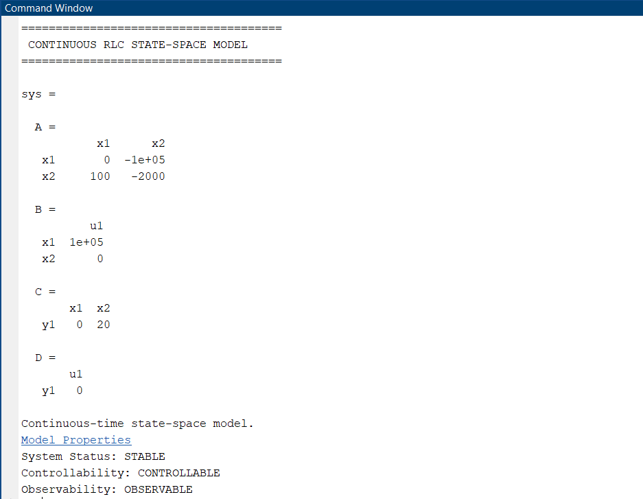
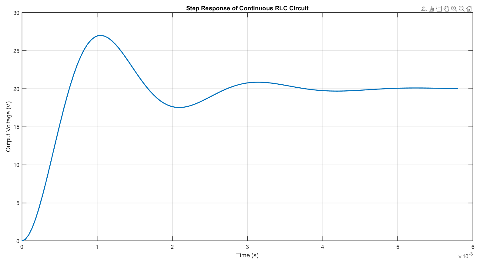
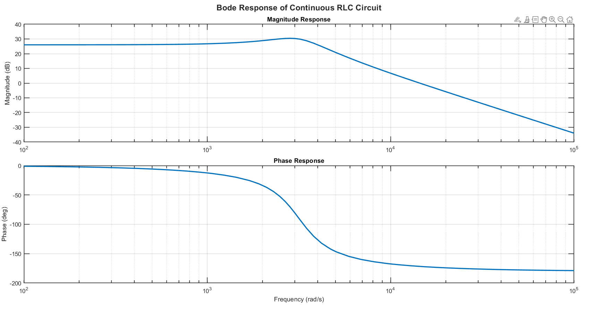
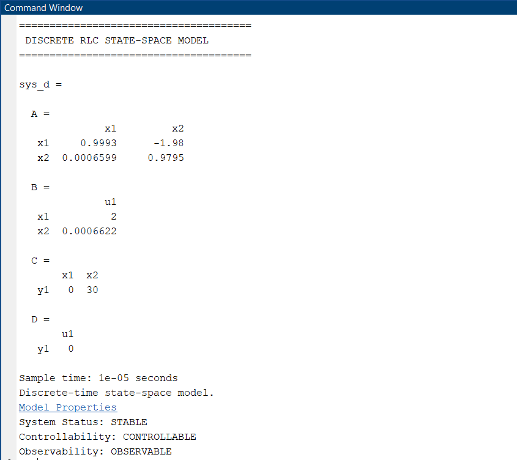
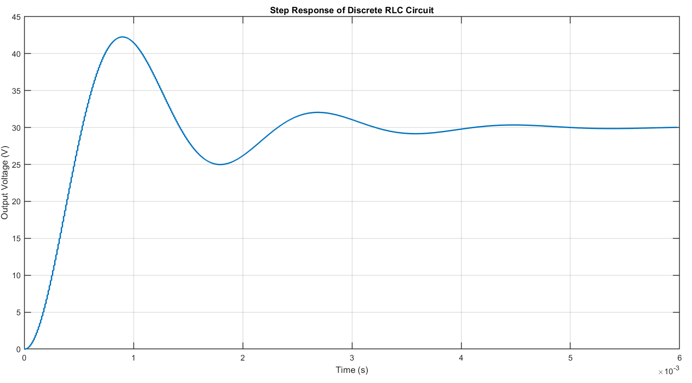
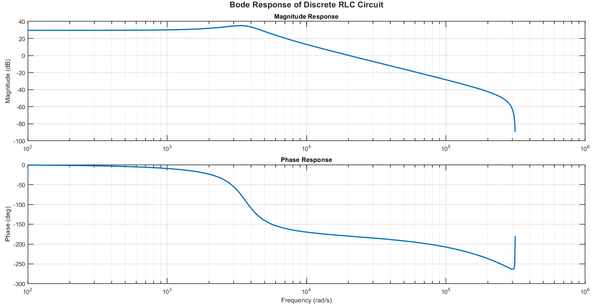

# 📊 LAB - 05: State-Space Modeling, Controllability, Observability & Bode Analysis

## 🎯 Objectives
* Formulate state-space representations ($A, B, C, D$) for second-order dynamical $RLC$ circuits.
* Evaluate system stability, Kalman controllability rank condition, and observability rank condition.
* Simulate and visualize transient time-domain step responses and frequency-domain Bode responses (magnitude and phase).
* Convert continuous-time state-space models into discrete-time models via zero-order hold discretization (`c2d`).

---

## 📂 Source Code & Description

| Script | Domain | System Parameters | Analysis Performed |
| :--- | :---: | :--- | :--- |
| [`LAB0501.m`](LAB0501.m) | **Continuous-Time** | $R = 20\ \Omega$ $L = 10\ \text{mH}$ $C = 10\ \mu\text{F}$ | State-space formulation (`ss`), `isstable`, controllability rank (`ctrb`), observability rank (`obsv`), `step` response, and `bode` plot |
| [`LAB0502.m`](LAB0502.m) | **Discrete-Time** | $R = 30\ \Omega$ $L = 15\ \text{mH}$ $C = 5\ \mu\text{F}$ $T_s = 10\ \mu\text{s}$ | Continuous-to-discrete conversion (`c2d`), discrete stability, discrete controllability & observability, discrete step response (`stairs`), and discrete Bode analysis |

---

## 📈 Simulation Outputs

### 1. Continuous RLC Circuit Responses
| Figure | Description |
| :--- | :--- |
|  | Terminal display of continuous state-space matrices, stability, controllability, and observability verdicts |
|  | Step response: output voltage transient response across capacitor |
|  | Bode magnitude (dB) and phase (deg) frequency response |

### 2. Discrete RLC Circuit Responses
| Figure | Description |
| :--- | :--- |
|  | Terminal display of discrete state-space matrices ($A_d, B_d, C_d, D_d$), stability, controllability, and observability verdicts |
|  | Discrete-time step response using zero-order hold `stairs` visualization |
|  | Discrete frequency response (Bode magnitude and phase) |

