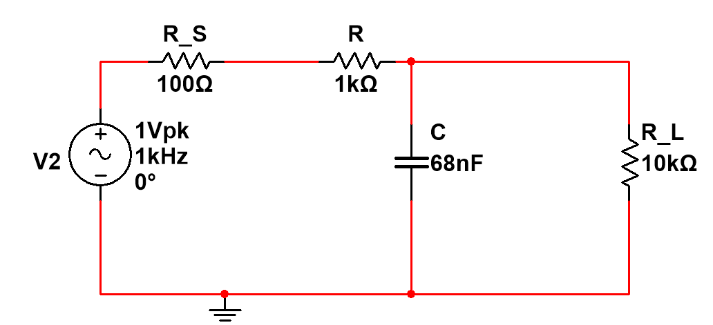
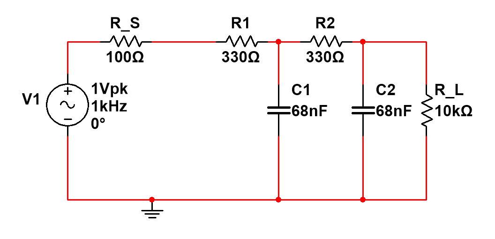
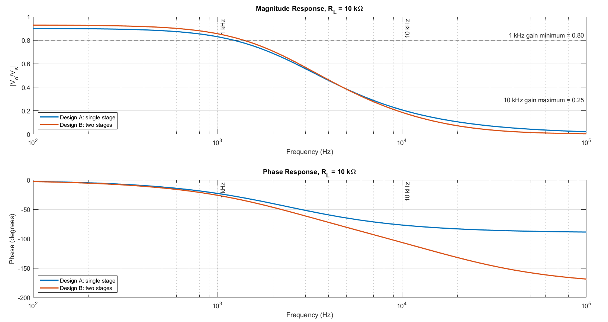
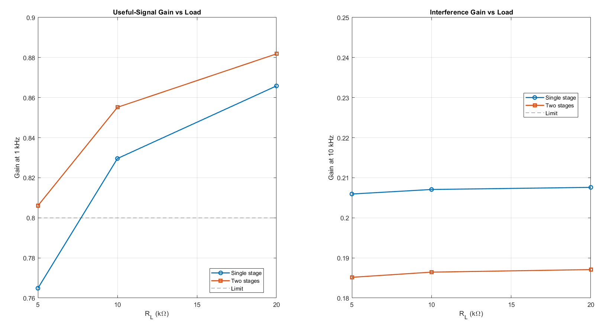
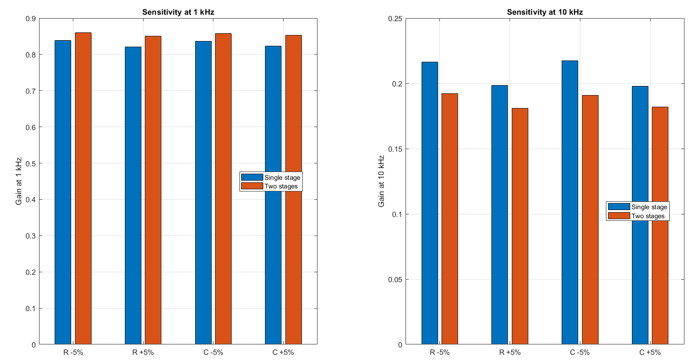
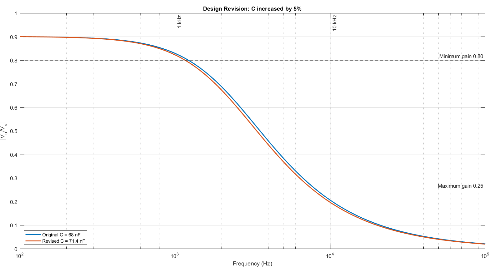
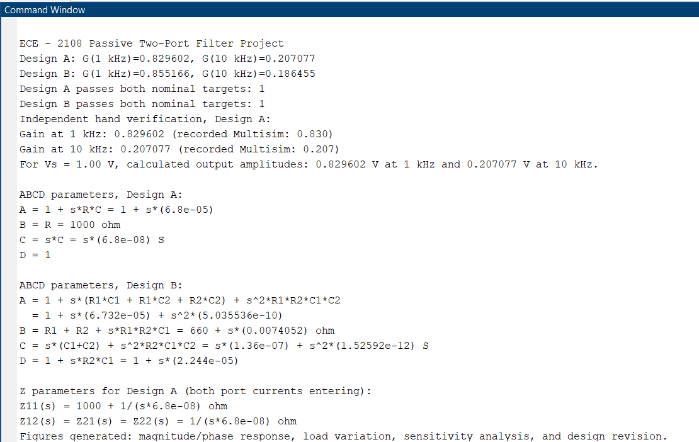

<div align="center">

# ⚡ ECE 2108: Design & Simulation of a Passive Two-Port Filter Network

[](https://www.kuet.ac.bd)
[](matlab/ECE2108_Passive_Two_Port_Filter.m)
[](multisim/ECE-2108-Project-01.ms14)
[](LICENSE)
[](SECURITY.md)

<p align="center">
  <b>Department of Electronics and Communication Engineering</b><br>
  <b>Khulna University of Engineering & Technology (KUET)</b><br>
  <i>Author:</i> <b>Kankon Mondal</b>
</p>

---

[Overview](#-executive-overview) •
[Specifications](#-target-specifications--constraints) •
[Circuit Topologies](#-circuit-topologies--schematics) •
[Two-Port Formulations](#-two-port-network-formulations) •
[Results & Benchmarks](#-results--comparative-benchmarking) •
[Simulation Visualizations](#-simulation-visualizations) •
[Project Structure](#-repository-structure) •
[Quickstart](#-quickstart-guide) •
[License & Security](#-license--security)

---

</div>

## 📌 Executive Overview

In real-world biomedical, acoustic, and sensor telemetry systems, transducers frequently capture low-frequency signals contaminated by high-frequency electromagnetic interference (EMI) or power electronics switching noise.

This project delivers a comprehensive investigation, analytical derivation, MATLAB numerical simulation, and NI Multisim 14 SPICE verification for **passive low-pass RC two-port filter networks**. Two distinct configurations were synthesized to preserve a **1 kHz** sensor signal while aggressively suppressing **10 kHz** high-frequency noise under real source and finite load impedances.

### 🌟 Key Highlights & Engineering Conclusions
* **Rigorous Two-Port Modeling:** Formulated complete closed-form transfer functions, transmission matrices (ABCD parameters), and open-circuit impedance parameters (Z parameters) incorporating source impedance ($R_s = 100\ \Omega$) and load impedance ($R_L = 10\ \text{k}\Omega$).
* **Cross-Platform Verification:** MATLAB computational predictions were correlated directly against independent hand derivations and NI Multisim 14 SPICE transient/AC sweep simulations ($<0.05\%$ discrepancy).
* **Load Robustness Finding:** At heavy loading ($R_L = 5\ \text{k}\Omega$), **Design A fails** the passband specification ($G = 0.765 < 0.80$). In contrast, **Design B sustains compliance** ($G = 0.806 \ge 0.80$), establishing Design B as the superior choice for varying load conditions.
* **Tolerance & Revision Analysis:** Evaluated component tolerance sensitivity ($\pm 5\%$) and proved a $+5\%$ capacitor revision in Design A optimizes stopband rejection ($0.207 \to 0.198$) with negligible passband loss.

---

## 🎯 Target Specifications & Constraints

The filter was designed to meet strict passband and stopband criteria simultaneously at the nominal operating point while adhering to practical component count constraints.

| Parameter | Symbol | Specification Limit | Description & Purpose |
| :--- | :---: | :---: | :--- |
| **Source Resistance** | $R_s$ | $100\ \Omega$ | Output impedance of the signal transducer |
| **Nominal Load Resistance** | $R_L$ | $10\ \text{k}\Omega$ | Input impedance of the subsequent amplifier/ADC |
| **Tested Load Variations** | $R_{L,\text{var}}$ | $5\ \text{k}\Omega,\ 20\ \text{k}\Omega$ | Extreme loading conditions for stability verification |
| **Input Source Voltage** | $V_s$ | $1.0\ \text{V}_\text{pk}$ | Standardized AC test potential |
| **Useful Signal Frequency** | $f_1$ | $1.0\ \text{kHz}$ | **Passband:** Minimum Gain $\|V_o / V_s\| \ge \mathbf{0.80}$ (Max loss: $1.938\ \text{dB}$) |
| **Interference Frequency** | $f_2$ | $10.0\ \text{kHz}$ | **Stopband:** Maximum Gain $\|V_o / V_s\| \le \mathbf{0.25}$ (Min attenuation: $12.04\ \text{dB}$) |
| **Simulation Frequency Band** | $f$ | $100\ \text{Hz} - 100\ \text{kHz}$ | Logarithmic frequency sweep |
| **Component Budget** | — | $\le 4\ \text{components}$ | Passive resistors and capacitors only (excluding $R_s, R_L$) |

---

## ⚡ Circuit Topologies & Schematics

Two candidate networks were designed, analyzed, and implemented:

### Topology 1: Design A (Single-Stage RC Low-Pass Filter)
* **Components:** Resistor $R = 1\ \text{k}\Omega$, Capacitor $C = 68\ \text{nF}$ (Total filter component count = 2)
* **Architecture:** First-order $L$-section network with series resistance and shunt capacitance.
* **Advantage:** Low cost, minimal board area, straightforward layout.

<p align="center">
  
  <br>
  <em>Figure 1: Schematic diagram of Design A (Single-Stage RC Low-Pass Filter with $R_s = 100\ \Omega$ and $R_L = 10\ \text{k}\Omega$).</em>
</p>

---

### Topology 2: Design B (Dual-Stage Cascaded RC Low-Pass Filter)
* **Components:** $R_1 = 330\ \Omega$, $R_2 = 330\ \Omega$, $C_1 = 68\ \text{nF}$, $C_2 = 68\ \text{nF}$ (Total filter component count = 4)
* **Architecture:** Second-order cascaded $RC$ ladder network.
* **Advantage:** Steeper roll-off ($-40\ \text{dB/decade}$ asymptotic slope), enhanced load isolation, superior interference rejection.

<p align="center">
  
  <br>
  <em>Figure 2: Schematic diagram of Design B (Dual-Stage Cascaded RC Low-Pass Filter with inter-stage interaction).</em>
</p>

---

## 📐 Two-Port Network Formulations

<details>
<summary><b>▶ Click to expand mathematical derivations (Transfer Functions, ABCD, and Z Parameters)</b></summary>

<br>

### 1. Design A Analytical Transfer Function
Taking into account source resistance $R_s$ and load resistance $R_L$, the equivalent series impedance is $R_T = R_s + R$. The output voltage across $R_L \parallel \frac{1}{sC}$ yields:

$$H_A(s) = \frac{V_o(s)}{V_s(s)} = \frac{R_L}{(R_s + R + R_L) + s C (R_s + R) R_L}$$

Evaluating along the imaginary axis $s = j\omega = j 2\pi f$:

$$|H_A(j\omega)| = \frac{R_L}{\sqrt{(R_s + R + R_L)^2 + \big[\omega C (R_s + R) R_L\big]^2}}$$

### 2. Design B Exact Nodal Transfer Function
Due to the inter-stage loading between the first and second $RC$ pairs, nodal admittance equations at Node 1 (junction of $R_1, C_1, R_2$) and Node 2 (output) are formulated as:

$$G_s = \frac{1}{R_s + R_1}, \quad G_2 = \frac{1}{R_2}, \quad Y_\text{out}(s) = \frac{1}{R_L} + s C_2$$

$$H_B(s) = \frac{V_o(s)}{V_s(s)} = \frac{G_s G_2}{(G_s + s C_1 + G_2)(G_2 + Y_\text{out}) - G_2^2}$$

### 3. ABCD Transmission Parameters
With transmission convention $\begin{bmatrix} V_1 \\ I_1 \end{bmatrix} = \begin{bmatrix} A & B \\ C & D \end{bmatrix} \begin{bmatrix} V_2 \\ I_2 \end{bmatrix}$ (where $I_2$ exits port 2, external to $R_s$ and $R_L$):

* **Design A Matrix:**
  $$\mathbf{T}_A(s) = \begin{bmatrix} 1 + sRC & R \\ sC & 1 \end{bmatrix} = \begin{bmatrix} 1 + s(6.8 \times 10^{-5}) & 1000 \\ s(6.8 \times 10^{-8}) & 1 \end{bmatrix}$$

* **Design B Matrix (Cascade of two L-sections):**
  $$\mathbf{T}_B(s) = \mathbf{T}_1(s) \times \mathbf{T}_2(s) = \begin{bmatrix} 1 + s(R_1 C_1 + R_1 C_2 + R_2 C_2) + s^2 R_1 R_2 C_1 C_2 & R_1 + R_2 + s R_1 R_2 C_1 \\ s(C_1 + C_2) + s^2 R_2 C_1 C_2 & 1 + s R_2 C_1 \end{bmatrix}$$

### 4. Open-Circuit Impedance Parameters (Z-Parameters, Design A)
Convention with both port currents entering:
$$Z_{11}(s) = R + \frac{1}{sC} = 1000 + \frac{1}{s(6.8 \times 10^{-8})}\ \Omega$$
$$Z_{12}(s) = Z_{21}(s) = Z_{22}(s) = \frac{1}{sC} = \frac{1}{s(6.8 \times 10^{-8})}\ \Omega$$

</details>

---

## 📊 Results & Comparative Benchmarking

### 1. Nominal Performance Comparison ($R_L = 10\ \text{k}\Omega$)

| Performance Indicator | Target Criteria | Design A (Single-Stage) | Design B (Dual-Stage) | Multisim Verification | Compliance Status |
| :--- | :---: | :---: | :---: | :---: | :---: |
| **Gain at 1 kHz ($f_1$)** | $\ge \mathbf{0.800}$ | **$0.8296$** ($0.830\ \text{V}$) | **$0.8552$** ($0.855\ \text{V}$) | $0.830\ \text{V}$ | :white_check_mark: **PASS** |
| **Gain at 10 kHz ($f_2$)** | $\le \mathbf{0.250}$ | **$0.2071$** ($0.207\ \text{V}$) | **$0.1865$** ($0.186\ \text{V}$) | $0.207\ \text{V}$ | :white_check_mark: **PASS** |
| **10 kHz Noise Suppression** | Min $12.04\ \text{dB}$ | $-13.68\ \text{dB}$ | **$-14.59\ \text{dB}$** | $-13.68\ \text{dB}$ | :white_check_mark: **PASS** |
| **Component Count** | $\le 4$ | **2 components** | 4 components | — | :white_check_mark: **Within Budget** |

> **Key Observation:** Design B delivers **$+0.0256$ greater passband voltage** at $1\ \text{kHz}$ and **$-0.0206$ stronger interference rejection** at $10\ \text{kHz}$ compared to Design A.

---

### 2. Load Robustness Study ($R_L = 5\ \text{k}\Omega,\ 10\ \text{k}\Omega,\ 20\ \text{k}\Omega$)

Load variation represents fluctuations in downstream stage input impedance. The table below presents the quantitative performance under variable load:

| Load Resistance ($R_L$) | Loading Condition | Design A (1 kHz) | Design A (10 kHz) | Design B (1 kHz) | Design B (10 kHz) | Result Summary |
| :--- | :--- | :---: | :---: | :---: | :---: | :--- |
| **$5\ \text{k}\Omega$** | Heavy Load | $0.765$ :x: | $0.206$ :white_check_mark: | **$0.806$** :white_check_mark: | **$0.185$** :white_check_mark: | **Design A fails; Design B satisfies all limits** |
| **$10\ \text{k}\Omega$** | Nominal Load | $0.830$ :white_check_mark: | $0.207$ :white_check_mark: | **$0.855$** :white_check_mark: | **$0.186$** :white_check_mark: | Both designs pass |
| **$20\ \text{k}\Omega$** | Light Load | $0.865$ :white_check_mark: | $0.207$ :white_check_mark: | **$0.885$** :white_check_mark: | **$0.200$** :white_check_mark: | Both designs pass comfortably |

> [!IMPORTANT]
> **Load Sensitivity Finding:** When $R_L$ drops to $5\ \text{k}\Omega$, excess voltage division occurs across the series elements. Design A's useful-signal gain drops to **$0.765$** (violating the $0.80$ limit). Design B maintains **$0.806$**, demonstrating that the dual-stage architecture is essential for systems subject to variable loading.

---

### 3. Component Tolerance Sensitivity Analysis ($\pm 5\%$)

Standard commercial components feature $\pm 5\%$ manufacturing tolerances. Each component was perturbed independently by $\pm 5\%$ while holding others nominal at $R_L = 10\ \text{k}\Omega$:

| Variation Parameter | Single-Stage (1 kHz) | Single-Stage (10 kHz) | Dual-Stage (1 kHz) | Dual-Stage (10 kHz) | Compliance |
| :--- | :---: | :---: | :---: | :---: | :---: |
| **Nominal Baseline** | $0.830$ | $0.207$ | $0.855$ | $0.186$ | :white_check_mark: PASS |
| **Resistor $-5\%$** | $0.838$ | $0.216$ | $0.863$ | $0.196$ | :white_check_mark: PASS |
| **Resistor $+5\%$** | $0.820$ | $0.198$ | $0.847$ | $0.177$ | :white_check_mark: PASS |
| **Capacitor $-5\%$** | $0.835$ | $0.217$ | $0.854$ | $0.188$ | :white_check_mark: PASS |
| **Capacitor $+5\%$** | $0.823$ | $0.198$ | $0.840$ | **$0.167$** | :white_check_mark: PASS |

> **Insight:** In all scenarios, tolerances remain strictly compliant. Increasing capacitance yields the most pronounced interference reduction, driving Design B's $10\ \text{kHz}$ gain down to **$0.167$**.

---

### 4. Design Revision Study (Single-Stage $C \to +5\%$)

To optimize stopband attenuation without exceeding component count, a trial design revision was executed by increasing Design A capacitance from $68\ \text{nF}$ to $71.4\ \text{nF}$ ($+5\%$):

| Operating Condition | Original ($C = 68\ \text{nF}$) | Revised ($C = 71.4\ \text{nF}$) | Net Delta ($\Delta$) | Engineering Impact |
| :--- | :---: | :---: | :---: | :--- |
| **Gain at 1 kHz** | $0.8296$ ($0.830$) | **$0.8242$** | $-0.0054$ | Negligible decrease, remains $>0.80$ |
| **Gain at 10 kHz** | $0.2071$ ($0.207$) | **$0.1981$** | **$-0.0090$** | **Improved noise rejection by $4.3\%$** |

---

## 📈 Simulation Visualizations

### Frequency Response (Bode Magnitude & Phase)
Logarithmic sweep from $100\ \text{Hz}$ to $100\ \text{kHz}$ showing passband flatness, $-3\ \text{dB}$ cutoffs, and stopband attenuation rates.
<p align="center">
  
</p>

### Load Sensitivity Analysis
Comparison of useful signal preservation ($1\ \text{kHz}$) and interference transmission ($10\ \text{kHz}$) as load ranges from $5\ \text{k}\Omega$ to $20\ \text{k}\Omega$.
<p align="center">
  
</p>

### Component Tolerance Sensitivity
Sensitivity distribution of gain metrics subject to $\pm 5\%$ variations in resistance and capacitance.
<p align="center">
  
</p>

### Design Revision Verification
Evaluation of frequency curve shift resulting from increasing Design A capacitance by $+5\%$.
<p align="center">
  
</p>

### Numerical Command Window Execution Log
Direct MATLAB command execution validating hand derivations, ABCD parameters, and Multisim correlation.
<p align="center">
  
</p>

---

## ⚖️ Trade-off Decision Matrix

| Evaluation Dimension | Design A (Single-Stage) | Design B (Dual-Stage) | Preferred Selection |
| :--- | :---: | :---: | :---: |
| **Passband Transmission ($1\ \text{kHz}$)** | $0.830$ | **$0.855$** | **Design B** (+3.0%) |
| **Stopband Rejection ($10\ \text{kHz}$)** | $0.207$ | **$0.186$** | **Design B** (+10.1% better) |
| **Stability Under Heavy Load ($5\ \text{k}\Omega$)** | **Fails ($0.765$)** | **Passes ($0.806$)** | **Design B** |
| **Roll-off Steepness** | $-20\ \text{dB/dec}$ | **$-40\ \text{dB/dec}$** | **Design B** |
| **Component Economy & BOM Cost** | **2 Components** | 4 Components | **Design A** |
| **Circuit Simplicity & Tuning** | **Straightforward** | Inter-stage loading | **Design A** |
| **Final Recommendation** | *Simplicity priority* | *Performance priority* | **🏆 Design B** |

---

## 📁 Repository Structure

```text
ECE-2108-KUET/
├── docs/                                 # Documentation & comprehensive reports
│   ├── details.md                        # In-depth analytical breakdown & audit
│   └── ECE 2108 Lab Project.pdf          # Full 24-page academic lab report
├── figures/                              # Graphic assets and simulation captures
│   ├── plots/                            # High-resolution MATLAB analysis figures
│   │   ├── 01_command_window_output.png  # Terminal printout & ABCD/Z values
│   │   ├── 02_magnitude_phase_response.png# Frequency sweep (Magnitude & Phase)
│   │   ├── 03_load_variation.png         # Gain vs Load Resistance (5k to 20k)
│   │   ├── 04_sensitivity_analysis.png   # +/- 5% tolerance sensitivity bars
│   │   └── 05_design_revision.png        # +5% capacitance revision comparison
│   └── schematics/                       # Circuit schematics
│       ├── Dual_Stage.png                # Two-stage cascaded schematic
│       └── Single_Stage.png              # Single-stage passive schematic
├── matlab/                               # Numerical simulation code
│   └── ECE2108_Passive_Two_Port_Filter.m # Standalone MATLAB script (R2016b+)
├── multisim/                             # SPICE simulation designs
│   └── ECE-2108-Project-01.ms14          # NI Multisim 14 circuit schematic
├── .gitignore                            # Temp and autosave file exclusions
├── LICENSE                               # Permissive MIT License
├── README.md                             # Repository showcase & documentation
└── SECURITY.md                           # Security guidelines & reporting policy
```

---

## 🚀 Quickstart Guide

### Running the MATLAB Simulation
The script is self-contained and uses standard base MATLAB functions:

1. Open MATLAB (R2016b or newer).
2. Set the current directory to `matlab/` or add it to your path:
   ```matlab
   cd('matlab');
   ```
3. Execute the simulation:
   ```matlab
   ECE2108_Passive_Two_Port_Filter
   ```
4. All 4 figure windows will render automatically, and analytical parameters (ABCD and Z-matrices) will display in the Command Window.

### Running the Multisim Simulation
1. Launch **NI Multisim 14.0** or later.
2. Open `multisim/ECE-2108-Project-01.ms14`.
3. Select **Simulate > Analyses > AC Analysis** or **Interactive Simulation**.
4. Observe the probe voltages at $1\ \text{kHz}$ and $10\ \text{kHz}$ across $R_L$.

---

## 🔒 License & Security

* **License:** This project is licensed under the terms of the [MIT License](LICENSE). You are free to use, modify, and distribute this work for academic and educational purposes.
* **Security Policy:** We adhere to safe open-source software practices. For information on reporting vulnerabilities and safe simulation execution guidelines, please consult [SECURITY.md](SECURITY.md).

---

<div align="center">
  <sub>Developed for ECE 2108 · Department of Electronics and Communication Engineering · Khulna University of Engineering & Technology (KUET)</sub>
</div>
